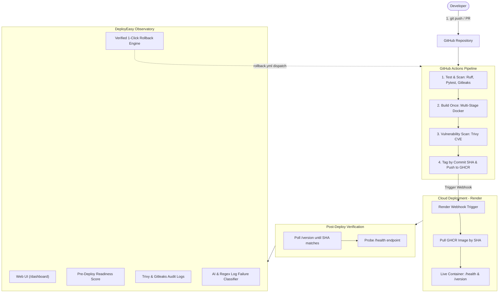

# DeployEasy 🚀

> **Production-Grade GitOps Deployment Platform & Release Observatory**  
> *Zero-downtime releases, verified 1-click rollback, pre-deploy readiness gates, and automated supply-chain security for cloud-native applications.*

[](https://github.com/harshit5afk/deployeasy/actions/workflows/pipeline.yml)
[](LICENSE)
[](https://www.python.org/)
[](https://fastapi.tiangolo.com/)
[](https://www.docker.com/)
[](https://github.com/aquasecurity/trivy)
[-brightgreen)]()

---

## 📖 Overview

**DeployEasy** solves the pain of fragile, manual cloud deployments for engineering teams and junior developers. Manual deployments often lead to broken production releases, leaked environment credentials, and hours of downtime.

Designed and approved under the **PRISM Engineering Framework** (**Option 2: GitOps Container Pipeline**), DeployEasy automates the entire delivery cycle from a single `git push` to continuous health verification, backed by a visual telemetry dashboard and an instant rollback engine.



---

## ✨ Key Features

### 1. 🔄 3-Stage GitOps CI/CD Pipeline
- **Continuous Quality**: Ruff linter, Pytest test suite, and Gitleaks secret scanning block broken code and credentials before build.
- **Single Build Rule**: The Docker container is built **only once** per commit SHA and stored immutably in GitHub Container Registry (GHCR).
- **Automated Delivery**: On merge to `main`, the image is scanned by Trivy and deployed to cloud hosting via authenticated deploy hooks.
- **Zero-Guess Smoke Verification**: Automatically polls `/version` until the live container confirms running the target commit SHA, followed by `/health` validation.

### 2. ⚡ Verified 1-Click Rollback
- Encounter a production defect? Select any historical healthy release in the dashboard and trigger an instant rollback.
- Dispatches `.github/workflows/rollback.yml` with the exact 40-character target Git commit SHA.
- **No False Positives**: DeployEasy monitors the live instance and **only records success** once the target `/version` endpoint confirms the rollback SHA is live.

### 3. 🛡️ Enterprise-Grade Security & Reliability
- **SSRF Defense**: Custom DNS re-resolution and IP filtering blocks loopback (`127.0.0.1`), private subnets (RFC 1918), and AWS/GCP cloud metadata endpoints (`169.254.169.254`).
- **Owner-Scoped Multi-Tenancy**: All project configurations, deployments, and probes enforce authenticated user-level authorization (`owner_id`).
- **Session Security**: Persistent database-backed sessions with secure `HttpOnly`, `SameSite=Lax` cookies (no insecure `localStorage` tokens).
- **CSRF Protection**: Double-submit CSRF tokens enforced on all state-changing endpoints.
- **Supply-Chain Integrity**: GitHub Actions workflows pin third-party actions to immutable commit SHAs.

### 4. 📊 Release Observatory & Control Center
- **Pre-Deploy Readiness Gate**: Evaluates a 0–100% composite safety score across CI results, CVE severity, and environment variable configuration.
- **Environment Validator**: Inspects `.env` files for missing production keys, unreplaced template placeholders (`change_me_in_prod`), and malformed URLs.
- **Deployment Log Diagnostics**: Pattern-matching engine automatically identifies Pytest failures, Ruff lint errors, Docker build bugs, and timeouts with copy-paste remediation commands.
- **Cloud Cost Estimator (FinOps)**: Activity-based forecasting model calculates monthly compute and bandwidth spend with optimization tips.

---

## 🏗️ Architecture & Framework Alignment

DeployEasy is engineered according to the **SmartX Technologies PRISM Framework**:

| PRISM Document | Focus | Status & Decision |
| :--- | :--- | :--- |
| **PRISM-P** *(Problem Brief)* | Problem identification, user pain, baseline MTTR metrics | Approved (Gate M0 → M1) |
| **PRISM-R** *(PRD-Lite)* | Functional (FR-01 to FR-08) & Non-Functional requirements | Approved (Gate M1 → M2) |
| **PRISM-I** *(Options Matrix)* | Evaluated Option 1 (Scripts), Option 2 (GitOps), Option 3 (K8s) | **Option 2 Selected** (Gate M2 → M3) |
| **PRISM-S** *(Design Doc / RFC)* | Multi-stage pipeline, API contracts, Alembic migrations, ADRs | **Design Frozen** (Gate M3 → M4) |
| **PRISM-M** *(Task Breakdown)* | Epics E-01 through E-06, Story acceptance criteria | **Fully Executed** (Gate M4 → M5) |

---

## 🚀 Quick Start (Local Development)

### Prerequisites
- Python 3.11+
- Node.js & npm (optional, for convenient npm scripts)
- Docker & Docker Compose (optional)

### Option A: Using npm Scripts (Recommended)
```bash
# 1. Install Python dependencies
pip install -r requirements.txt -r requirements-dev.txt

# 2. Build React production bundle
npm run build:frontend

# 3. Start development server (auto-reloads on port 8080)
npm start

# 4. Run full test suite & linter
npm test
npm run lint
```

### Option B: Standalone React Dev Server (Vite)
```bash
# Run FastAPI backend on port 8080
npm run dev:backend

# In a separate terminal, run Vite dev server with hot reload on port 5173
npm run dev:frontend
```
Vite automatically proxies all `/api/*`, `/health`, `/version`, `/metrics`, and `/demo` calls to `http://127.0.0.1:8080`.

### Option C: Using Python & Uvicorn Directly
```bash
# Apply Alembic migrations
alembic upgrade head

# Run unit and security tests (74 tests)
python -m pytest -v

# Run linter
python -m ruff check .

# Start FastAPI server
uvicorn app.main:app --port 8080 --reload
```

Server will be running at: **`http://localhost:8080`**  
- **Landing Page**: `http://localhost:8080/`
- **Login / Demo Access**: `http://localhost:8080/login`
- **Control Center Dashboard**: `http://localhost:8080/dashboard`

---

## 📡 API Reference

| Method | Path | Description | Auth Required |
| :--- | :--- | :--- | :---: |
| `GET` | `/` | Developer-first marketing and product landing page | No |
| `GET` | `/login`, `/signup` | Authentication and 1-click Demo Developer access | No |
| `GET` | `/dashboard` | Multi-view deployment observatory and control center | Yes (or Demo) |
| `GET` | `/health` | Live availability check for Docker, Render, and monitors | No |
| `GET` | `/version` | Running application version and Git commit SHA | No |
| `GET` | `/metrics` | Process uptime and HTTP request metrics | No |
| `POST`| `/api/auth/login` | Authenticate user and issue secure `HttpOnly` cookie | No |
| `POST`| `/api/auth/register` | Register new user account with rate limiting | No |
| `POST`| `/api/auth/demo-login` | Instant demo developer workspace login | No |
| `POST`| `/api/auth/logout` | Invalidate persistent session token | Yes |
| `GET` | `/api/projects` | List connected projects scoped to authenticated user | Yes |
| `POST`| `/api/projects` | Register a new repository and deployment hook | Yes |
| `GET` | `/api/projects/{id}/deployments` | Retrieve deployment history with status and duration | Yes |
| `POST`| `/api/deployments/trigger` | Trigger a new deployment via GitHub Actions or hook | Yes |
| `POST`| `/api/deployments/rollback` | Execute verified 1-click rollback to a specific SHA | Yes |
| `GET` | `/api/deployments/{id}/diff` | Compare Git commits and file changes between releases | Yes |
| `GET` | `/api/projects/{id}/readiness` | Calculate 0-100% pre-deploy safety gate score | Yes |
| `POST`| `/api/projects/{id}/check-health`| Execute SSRF-safe live probe against target URL | Yes |
| `GET` | `/api/projects/{id}/security` | Retrieve Trivy CVE findings and Gitleaks scan reports | Yes |
| `POST`| `/api/validate-env` | Validate `.env` configuration keys and placeholders | Yes |
| `POST`| `/api/analyze-logs` | Diagnose CI/CD build logs and provide remediation steps | Yes |

---

## ⚙️ Production Deployment Setup

Follow these steps to deploy DeployEasy to production:

1. **GitHub Repository**:
   - Push repository to GitHub.
   - In repo **Settings → Branches**, enable branch protection on `main` (require PR reviews and passing status checks).
2. **Container Registry (GHCR)**:
   - On the first push to `main`, GitHub Actions builds and pushes the image to GitHub Packages.
   - In GitHub **Packages → deployeasy**, set package visibility to **Public**.
3. **Cloud Web Service (Render)**:
   - Create a Web Service from an **Existing Image**: `ghcr.io/<github-username>/deployeasy:latest`.
   - Set Health Check Path: `/health`.
   - Set Environment Variables:
     - `PORT=8080`
     - `DEPLOYEASY_SECRET_KEY=<strong-random-secret>`
     - `DATABASE_URL=postgresql://...` *(optional: defaults to local persistent SQLite)*
4. **Deploy Hook & GitHub Secrets**:
   - In Render, copy your service's **Deploy Hook URL**.
   - In GitHub **Settings → Secrets and variables → Actions**, add:
     - Secret: `RENDER_DEPLOY_HOOK_URL` = `<your-render-deploy-hook-url>`
     - Variable: `SERVICE_URL` = `https://<your-render-app-name>.onrender.com`
5. **Synthetic Uptime Monitoring**:
   - Create a free monitor on [UptimeRobot](https://uptimerobot.com) targeting `https://<your-app>.onrender.com/health` with a 5-minute probe interval.

---

## 🧪 Testing & Quality Assurance

DeployEasy includes a comprehensive test suite of 74 unit, integration, and security tests:

```bash
# Run all tests with pytest
python -m pytest -v

# Run negative security tests specifically
python -m pytest tests/test_security_audit.py -v
```

**Test Coverage Areas:**
- Anonymous access prevention across all project endpoints.
- Cross-tenant owner authorization enforcement (preventing User A from accessing User B's projects).
- SSRF exploit payloads (IPv4 loopback, IPv6 loopback, cloud metadata `169.254.169.254`, private RFC 1918 subnets, DNS rebinding).
- Double-submit CSRF validation.
- Rollback SHA verification & failure handling.
- Alembic database migration integrity.

---

## 📚 Documentation Links

- 🏛️ [System Architecture](docs/architecture.md)
- 🚨 [Incident Response Playbook](docs/incident-response.md)
- 🎬 [Interactive Demo Script](docs/demo-script.md)
- 📄 [PRISM Framework Completion Reports](.)

---

## 📄 License

This project is licensed under the MIT License — see the [LICENSE](LICENSE) file for details.
