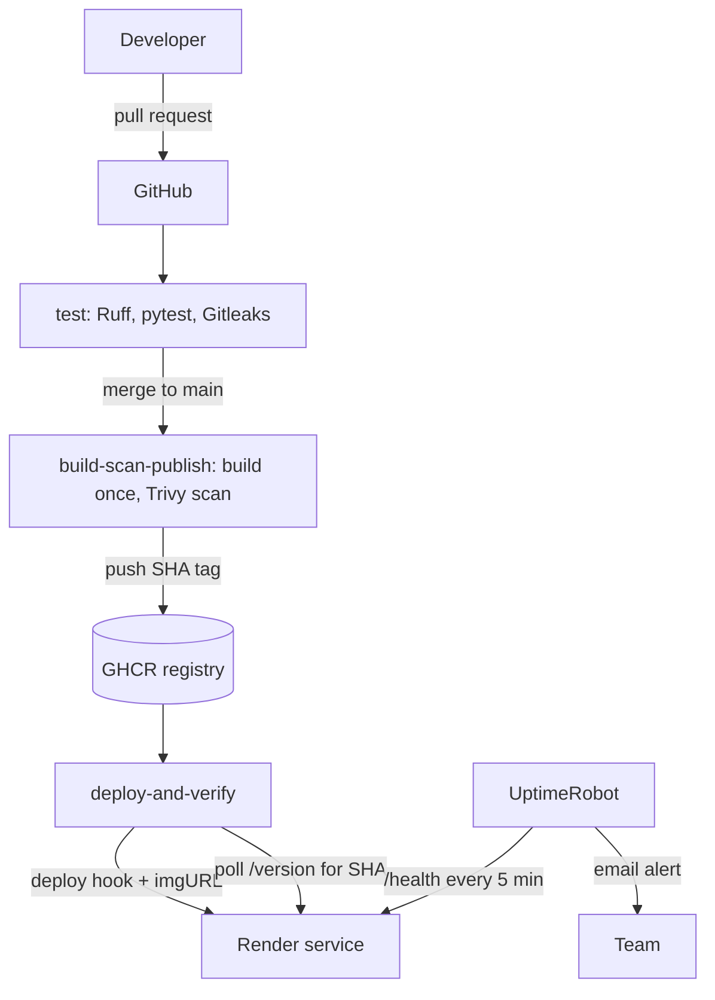

# Architecture

| Piece | Detail |
|---|---|
| App | FastAPI, one worker, port from `PORT` (default 8080) |
| Image | `ghcr.io/<owner>/deployeasy:<commit-sha>` (also `latest`) |
| Secrets | `RENDER_DEPLOY_HOOK_URL` (GitHub secret). `SERVICE_URL` (GitHub variable, not secret) |
| Triggers | Pull request: `test` + build and scan only. Push to `main`: full pipeline. Manual: `rollback.yml` |
| Safety | `production-deploy` concurrency group, so deployments never overlap |
